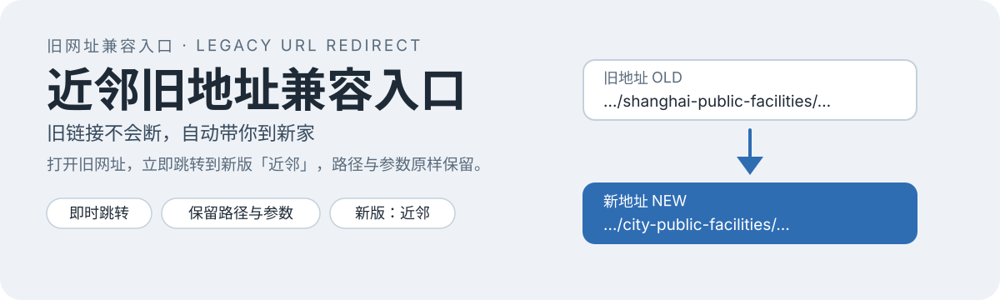

<p align="right"><a href="README.md">中文</a></p>

<p align="center">
  
</p>

<p align="center">
  <a href="https://holynova.github.io/shanghai-public-facilities/">▶ Old URL (auto-redirects)</a>
  ·
  <a href="https://holynova.github.io/city-public-facilities/">New 「近邻」 Site</a>
  ·
  <a href="https://github.com/holynova/city-public-facilities">New Repository</a>
</p>

This repository is a legacy-URL compatibility shim for 近邻 (City Public Facilities): after the project was renamed from `shanghai-public-facilities` to `city-public-facilities`, old links keep working — opening an old URL redirects instantly to the new site, preserving the path, query string, and hash.

## What It Does

- **Instant redirect**: `index.html` redirects via JavaScript (with a `<meta http-equiv="refresh">` fallback), targeting `https://holynova.github.io/city-public-facilities/`.
- **Path-preserving**: an old address `/shanghai-public-facilities/xxx` redirects to the new address `/city-public-facilities/xxx`; `?query` and `#hash` travel along.
- **404s redirect too**: `404.html` runs the same redirect logic as the homepage, so deep links that would 404 land on the matching new page.

## Files

```
index.html   Homepage redirect (JS + meta refresh, belt and suspenders)
404.html     404-page redirect (same logic)
README.md    This file
```

No build step, no dependencies. When the redirect target changes, update the URL in both HTML files.
