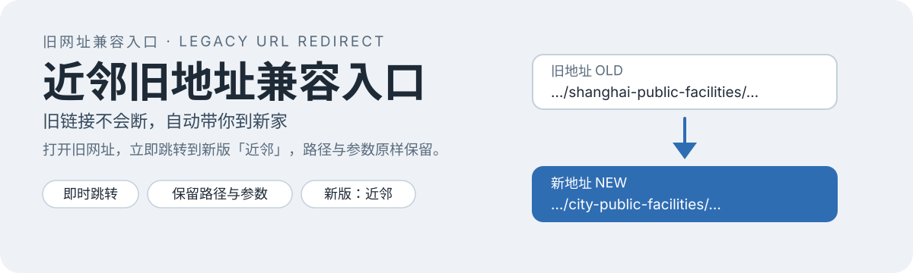

<p align="right"><a href="README.en.md">English</a></p>

<p align="center">
  
</p>

<p align="center">
  <a href="https://holynova.github.io/shanghai-public-facilities/">▶ 旧地址（自动跳转）</a>
  ·
  <a href="https://holynova.github.io/city-public-facilities/">新版「近邻」</a>
  ·
  <a href="https://github.com/holynova/city-public-facilities">新版仓库</a>
</p>

这个仓库是「近邻」（城市公共设施查询）旧网址的兼容入口：项目从 `shanghai-public-facilities` 更名为 `city-public-facilities` 后，旧链接不会断——打开旧网址会立即跳转到新版，路径、查询参数与锚点原样保留。

## 它做什么

- **即时跳转**：`index.html` 用 JS 立即跳转（另有 `<meta http-equiv="refresh">` 兜底），目标是 `https://holynova.github.io/city-public-facilities/`。
- **路径保留**：旧地址 `/shanghai-public-facilities/xxx` 跳转到新地址 `/city-public-facilities/xxx`；`?query` 与 `#hash` 一并带过去。
- **404 也跳转**：`404.html` 与首页是同一套跳转逻辑，深链接打不开时同样被带到新版对应页面。

## 文件

```
index.html   首页跳转（JS + meta refresh 双保险）
404.html     404 页跳转（同一套逻辑）
README.md    本文件
```

没有构建步骤，没有依赖。改跳转目标时，两个 HTML 文件里的目标地址要一起改。
